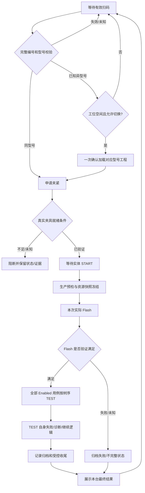

# AutoTest｜R7 全产品 UI/UX 完整研究与逐页面设计

**状态：设计候选；浏览器交互验证，不代表 WPF/ECU 实测。**


---
# 00｜R7 产品定位、决策继承与设计依据

**状态**：全产品 UI/UX 设计候选（`DESIGN_PROPOSED`）；浏览器交互已经测试，Windows/WPF、固件和真实 ECU 未由本工作证明。

## 1. 本轮研究从哪里开始

本设计不是 V5 换皮，也不是 R1 `TestEditorView` 改颜色。依据用户后来确认、已经在 `Project_Management/docs/project-management/current/` 留档的 `README` 与 `00—09` 全部业务合同，以及之前的 R6 独立研究文档。**`current/` 对产品决定的优先级高于被取代的 `current-20261121/`、旧 S-09/SCAN 配方提案、V4/V5 HTML 业务模型。**

本轮另参考：
- NI TestStand 的 Step Settings Pane：选中步骤与设置面板同步，调试/变量具有连续上下文。https://www.ni.com/docs/en-US/bundle/teststand-api-ref/page/tsref/step-settings-pane.html
- NI TestStand 面向工程师和操作员的不同工作界面：操作员不需要携带开发工具的全部复杂度。https://www.ni.com/en/support/documentation/supplemental/08/teststand-user-interface-development-best-practices.html
- Microsoft Windows Fluent 导航/命令/可访问性指导，注意工业软件的高信息密度。https://learn.microsoft.com/en-us/windows/apps/get-started/line-of-business/design-for-lob
- Vector CANape 多源信号测量/记录/分析。https://www.vector.com/en/product/canape/
- ASAM MDF 测量数据的时间序列、事件和附件表达。https://www.asam.net/standards/detail/mdf/

研究借鉴用户操作原则，不逐像素复制任何厂商 UI，不因为竞品支持某功能就假设当前工位硬件具备。

## 2. 六个平等能力与三种用户工作流

| 能力 | 产品责任 | 不能从属谁 |
|---|---|---|
| 独立工具 | 手动台架、DBC、UDS、独立烧录、波形可脱离工程工作 | 不是自动 TEST 的五个附属页面 |
| 公共资源 | DBC、固件、Seed/Key、参考波形、诊断序列、配置有明确来源/引用 | 不是生产或 TEST 私有存储 |
| ECU 工程 | 以一个型号为核心组织唯一有效 TEST 树、DBC、固件和生产配置 | 不要求同时选择多个当前方案 |
| 开发 TEST | 可编辑 DSL、单步/用例/勾选范围、断点/变量/失败控制 | 不依赖生产扫码/前置烧录 |
| 生产检测 | 扫码→型号→夹具→实体 START→每次 Flash→全部启用 TEST→报告→收尾 | 不是 TEST 编辑器的另一个运行按钮 |
| 记录与事实 | 原始 CAN/UDS/WAVE、StepOccurrence、单台报告、批量统计 | 不能由 UI 文本或扫码事件推断 PASS |

主窗口只有一个进程，默认两大模式 **工程师工作区** 和 **生产检测**，加独立 **记录与报告** 入口；五个专业工具为真正的 owned 窗口，不在主工作区里挤出大量通用三栏模板。工具可以无工程启动，数据源选择明确写明是“独立资源”还是“当前工程资源”。

## 3. 旧方案必须取代的决定

| 旧设计 | 新设计要求 | R7 中的体现 |
|---|---|---|
| 生产按 Recipe/TestProject/用例子集逐台选择 | 一个型号工程、一棵稳定有序 TEST 树 | 生产配置只设置型号/固件/烧录参数，不给逐台勾选 |
| 扫码后 PC 点击确认开始 | 核对型号→请求夹紧→等实体启动键 | 生产大屏没有“电脑开始检测”主要按钮 |
| NoFlash/ConditionalFlash 可选生产 | 每次完整检测，包括复检，都必须烧录 | 固定生产阶段，无“不烧录”开关 |
| 工具必须先建工程或与生产参数同一份 | 可无工程独立执行，资源引用显式 | 关闭工程后独立工具仍然打开且可编辑 |
| 生产 Flash 放在普通 TEST 步骤中 | 工位状态机在 TEST 之前执行 | R7 TEST 步骤选择器不引导插生产 Flash |
| 64B CAN FD 当作已支持 | 当前真机依据仅 classic CAN 0–8B | CAN 编辑 8 字节，DLC 0–8 |
| 波形能画就判 PASS | 需要来源/质量/审核版本/真实时间 | 仅显示数据和未批准候选，不生成 PASS |
| 把 USB ACK 当 ECU 响应 / 夹具到位 | 分离请求、接受、实际观测、最终结论 | 主界面/工具/生产一直显示真实未知/阻断状态 |

## 4. 已确认事实、研究建议、未验证前提

### 已确认（当前产品合同）

- Windows 离线 WPF/Prism、单 PC 单工位、单 DUT；主要支持 ECU 开发与出厂检测。
- 一个型号一个工程：当前有效一套 DBC、一份固件及生产 Flash 配置、一棵有序 TEST 用例树；目录分类无执行步骤，用例有准备/测试/清理。
- 工程修改自动保存，可恢复草稿；生产使用开始时冻结的有效资源，不受正在编辑的内容影响。
- 工具五个独立且无工程可用；无独立 CAN 工具，CAN 发送与日志在手动台架、TEST 及监视/记录路径内。
- 生产正常批量不使用鼠标；同型号无确认弹窗，已知跨型号工程可确认切换，未知不得猜测。
- KEY_SIM 20 个开关对应五路电阻网络，完整 20 位 Mask+保持时间，允许纯等待，不暗中 ReleaseAll。
- 目前主控实物只有经典 CAN 8 字节依据；CAN 角色按已冻结 ECU FlexCAN1、KEY FlexCAN0，不凭旧外壳编号推断。
- Flash 前置、每次必烧录、成功后才进入所有 Enabled 用例；每一次 PASS、FAIL、STOP、烧录失败都保留历史证据，记录不覆盖。

### 本轮设计建议（待用户确认）

- 视觉采用白色主工作区、浅灰蓝边框、少量蓝色主操作，按“正在编辑 / 当前运行 / 设备事实”降低不必要提示文本。
- 工程师使用左 246px 资源树、中央伸缩工作区、右 340px Inspector、可折叠 170px 底部观察区；具体尺寸允许拖拽、持久化及适配。
- 工作区一键切换工程师/生产/记录，工具浮窗以模块任务为中心，除非功能需要不重复绘制整个工程树。
- 生产全屏采用型号/工位顶栏、当前大状态、阶段轨、保留结果和低操作密度的紧凑配置入口。
- DBC 三域为“报文列表 / 当前报文信号连续编辑 / 详细字段”；波形三域为“信号与录波 / 多轨宽画布 / 质量与参考”，但这些是各自业务设计，不是套统一模板。

### 必须保留未定状态

- 客户真实条码格式、完整扫描枪 HID/CDC/COM/POS 输入边界；UT1 不能作为唯一正式编码。
- 实体 START/STOP 的 USB/IO、可靠夹具到位传感、STOP/故障机械恢复策略。
- 烧录原生 Profile 真正存储 Schema/固定路径及 CanTool 所有 XML 字段迁移。
- 参考波形采集时间源、采样质量、实际判定算法与 RECORD 证据类型。
- 批次边界、首次/最终良率、复检和放行统计策略以及单台/批量最终报告版式。
- R1 当前版本的正式发布范围；设计完整不等于要求 R1 首轮一定包含所有生产硬件闭环。

## 5. 验收素材真实性

示例 DBC 由用户此前提供的 `绿通通信矩阵.dbc` 解析为 13 报文、113 信号。文件本身标记为“来源整理、未实机校验”，不能在新 UI 里说已经真实验证。

示例 5 用例依据用户先前的 HydEPB 配置及已确认的驻车/释放动作、VCU 报文和关键状态信号重建，**不是原 R2 工程的逐字段导入**。维修释放/熄火驻车在设计样本中默认禁用，以避免给出未经核实的执行合同。

布局测试 CSV 文件名明确写“合成数据、非 ECU 实测”，只用于确认波形能同时画 4 路、处理放大/叠加。原型不预加载这份 CSV；创建参考时只能是未批准候选。


---
# 01｜R7 信息架构、全局设计系统和交互契约

## 1. 应用地图

```text
AutoTest（唯一 Windows 主进程）
├─ 工程师工作区（默认；当前工程可恢复）
│  ├─ 工程 / 文件树
│  │  ├─ 自动测试：按功能/故障分类的目录（目录无测试步骤）
│  │  │  └─ 每个用例：准备 / 测试 / 清理的步骤树
│  │  ├─ 公共流程：引用固定修订；与 TEST 一套 DSL
│  │  ├─ 当前 DBC、固件、参考波形、生产配置
│  │  └─ 记录/报告历史入口
│  ├─ 文档工作区：TEST 编辑 / 运行与调试共享当前上下文
│  ├─ 常驻 Inspector：当前用例/步骤参数和资源辅助
│  └─ 底部观察：问题、变量、StepOccurrence 时间线、CAN 原始日志
├─ 生产检测工作区（与开发空间隔离）
│  ├─ 生产操作：待扫码 / 夹具 / 实体 START / Flash / TEST / 报告 / 结果
│  ├─ 型号与生产配置：扫码型号规则、当前固件、原生 Flash Profile
│  ├─ 扫码与工位：真实设备接口、连接状态、硬件输入/到位证据
│  └─ 历史与追溯（非每台必操作）
├─ 记录与报告
│  ├─ 单台检测事实
│  ├─ 原始 CAN / UDS / WAVE 附件
│  ├─ TEST 关键数据/步骤时间线
│  └─ 固定格式批量报告
└─ 工具（主窗口拥有的独立 WPF 窗口；无工程也可使用）
   ├─ 手动台架：CAN/KEY/IGN/夹具与 CAN 监控
   ├─ DBC 编辑器：报文/信号/规范字段
   ├─ UDS 调试：服务序列/实际 NRC/日志
   ├─ ECU 烧录：三文件/原生参数/真实 10 阶段/CAN
   └─ 波形分析：多信号/录波/游标/标准参考
```

将“工具”和“公共资源”视为平等的产品概念，不把工具树强塞进工程导航。当无工程时，工具保持独立数据会话；从工程资源树打开时明确显示“正在编辑当前工程 DBC / 波形”。

## 2. 全局导航和工作区切换

- **顶部应用条**：产品标识、文件/编辑/运行/工具/视图菜单、主控 USB 与 ECU CAN 当前状态。这里不出现大量重复任务说明。
- **工作模式**：工程师、生产检测、记录与报告。模式切换不是关闭项目；工程师当前选中用例、步骤和底栏状态应保留。运行中的实体任务不允许用模式切换悄悄停止/切换 ECU。
- **工程身份**：当前工程与 ECU 型号使用稳定的可见标签。工程与型号不能用一个不含来源的“文件夹名”代替。
- **主命令区域**：一次只呈现当前视图最相关操作。TEST 主操作是新增步骤、调试范围、检查问题；生产主操作是查看实际状态、当前 DUT 编号及必要异常恢复，常规没有 PC“点击开始”。
- **多文档**：工程树单击切换同一中央工作区的测试用例；左树不是独立测试编辑器“启动器”。关闭文档标签不会删除工程中的用例。
- **工具菜单**：同一工具只有一个实例窗口，二次点击激活现有窗口。多个工具可同时打开观察；真实硬件写入由共享会话控制，与浮窗数目无关。

## 3. 窗口契约

| 窗口 | 能否无工程打开 | 使用哪些资源 | 是否能独立执行实体命令 | 主窗关闭行为 |
|---|---|---|---|---|
| TEST 主文档 | 否 | 型号工程当前资源 | 经受控 TEST 执行器 | 同主程序关闭，运行任务另走停止和安全控制 |
| 生产检测 | 可以进入界面；无有效工程不得生产 | 自动按已识别型号匹配唯一当前资源 | 生产状态机申请物理执行 | 不允许关闭界面后假报机械安全 |
| DBC | 是 | 独立 DBC / 当前工程 DBC（显式） | 无物理发送 | 受控保存，随主程序关闭 |
| 手动台架 | 是 | 独立动作与 CAN 配置，可选 DBC | 真实 DEVICE 会话许可才可下发 | 发送任务真实停止/归属交 DEVICE |
| UDS | 是 | 独立服务序列，可选工程端点 | 真实 ISO-TP/UDS 会话许可 | 正在执行必须取消或明确不可安全关闭 |
| 烧录 | 是 | 独立固件、算法、配置；可主动加载工程资源 | 真实 FLASH 引擎/授权 | 中断或退出行为受 Flash/DEVICE 合同，不由视觉界面假定成功 |
| 波形 | 是 | 独立信号/录波、工程参考 | 只读或采样；触发需实际能力 | 录波真实停止、数据完整性单独维护 |

UI 原型采用浏览器子窗口模拟 Owner 关系，正式 WPF 必须用同进程的 `Window.Owner`、统一窗口注册与关闭协调，并处理后台任务仍在执行的情况；不把浏览器测试当成 WPF 生命周期证明。

## 4. 布局与密度

- **默认窗口**：桌面 1600×900 优化，可从 1366×768 正常操作；列表和 Inspector 可滚动，未来 WPF 应支持拖动分隔线、布局恢复及高 DPI。
- **工程师**：树宽约 246px，中央自适应，右侧参数 340px，底部观察区默认 170px 可折叠。步骤表默认行高 40px、分组高 39px。
- **生产**：导航不占中央一栏，当前工位/当前 DUT 占主要视觉空间；阶段轨 7 节点，结果和设备条件是次要但清楚的信息。
- **五工具**：可大窗显示但默认不强制最大化。DBC 信号表可连续编辑；台架 CAN 每条卡片可一次看清 8B；波形宽度优先，4 条紧凑轨同时可见。
- **字体**：默认 13px 正文，12px 标签，11px 只用在密度较高的表头/元信息；当字号减小时必须保持对比度，不再塞入研发状态解释。
- **信息优先级**：真实任务名称/当前状态/关键参数 > 常用操作 > 说明/技术细节。屏幕上不常驻“本页面只是高保真演示”等研发文案。

## 5. 设计令牌

| Token | 值 | 目的 |
|---|---|---|
| `--surface` | `#FFFFFF` | 主内容 / 工具工作区 |
| `--bg` | `#F3F6FA` | 辅助背景 |
| `--ink` | `#203047` | 主文字 |
| `--secondary` | `#68798D` | 说明、未激活信息 |
| `--line` | `#DFE7F0` | 表格、卡片与窗体边界 |
| `--brand` | `#206AD4` | 当前选中与主要操作 |
| `--green` | `#147B60` | 真实已确认 OK / 完成事实 |
| `--amber` | `#A8701A` | 待检查/风险/未知 |
| `--red` | `#CB4A49` | 错误/阻断/真实 FAIL |
| 圆角 | 6–9px | Windows 桌面紧凑而不生硬 |
| 输入高度 | 31px | 适合连续表格编辑 |
| 常规按钮高度 | 32px | 鼠标操作清晰；支持键盘 |

颜色只表达真正语义。**USB 请求发出不能用“成功绿”代表 ECU 执行完成**；PASS/FAIL 是运行结果，不是任意操作按钮的颜色。

## 6. 控件与命令语义（必须通用）

### 文件与资源

- 点击树文件直接打开；当前资源身份、独立/工程来源显性区分。
- 导入后复制/纳入工程，不能只留外部源路径；替换 DBC/固件时做引用依赖审查，历史运行继续引用旧快照。
- 编辑自动保存草稿，非法字段保留但不能纳入正式执行；保存失败有明确当前文件、原因和恢复路径。
- Ctrl+S 可触发手动保存/写盘确认，但不把常规“保存”作为必做步骤。

### 用例与步骤

- 点击用例切换，不需要双击打开新进程；分类目录不拥有可执行步骤，只有用例才显示准备/测试/清理。
- `Enabled` 决定工程默认执行是否包含；`Selected` 只影响工程师临时调试范围；断点是调试标记；执行状态来自真实 Run。
- 新增步骤时先插入列表并选中，再在右侧 Inspector 修改。当前行显示摘要、资源引用、禁用、断点和（有 Run 时）真实状态。
- CAN 数据为主，DBC 编码是辅助。用户不必先在 DBC 新建某报文才能发原始 HEX。
- 当编辑 DBC 影响测试信号/参考采样，展示失效引用并阻断当前新执行计划，不覆盖历史原引用。
- 工程模板只在新建时复制到工程；修改工程不修改全局模板。

### 自动保存、撤销与恢复

- 每次参数更改、移动、插入或删除进入可恢复草稿与编辑历史；正式 WPF 应使用原子写入/备份、身份/修订一致性检查。
- 非法草稿的失败原因就地显示，不因用户改变输入而丢弃原文。
- 自动保存与运行冻结是两个不同对象：修改本次运行后的工程不能改变已经启动的本轮快照。
- 运行中强制修改工位状态、工程型号、执行目标时必须被真实后端限制，而不是 UI 自动迁移运行。

### 状态与日志

- 全产品统一使用“未连接 / 未就绪 / 待检查 / 正在执行 / 已停止 / 实际测量结果”等来源明确的词。
- CAN、UDS、Flash 进度、Wave 数据和 PASS/FAIL 都需要真实事件，信息展示时必须指出当前结果属于请求、ACK、ECU 观测还是正式判定。
- 单个 StepId 可能执行多次，记录详情必须使用 StepOccurrenceId/时间范围关联到真实数据，不借用其他循环中的观测。

## 7. 搜索、右键、快捷键与可访问性

- 工程树搜索：保留树节点层级，优先高亮/定位命中，不通过删除所有非命中节点破坏上下文。R7 HTML 当前实现为简单过滤，**WPF 正式实现需要补结构保留与命中高亮**。
- 步骤选择器：按 CAN、硬件、诊断、测量、流程分类，支持关键字搜索和键盘确认。
- 右键：步骤可复制、禁用/启用、断点、单步/运行到此处、删除；实际工程历史和运行冻结要保持。
- 推荐快捷键：`F9` 断点，`Ctrl+Space` 加步骤，`Ctrl+S` 保存，`Ctrl+Z/Y` 撤销重做，`F5` 运行当前范围，`F10` 单步；R7 HTML 当前仅实现 F9、Ctrl+Space、Ctrl+S 的交互，剩余为 WPF 设计规范，不虚称已完成。
- 输入验证使用 WPF `INotifyDataErrorInfo` 或等价机制；错误能定位到字段，支持键盘焦点、Tab 顺序及高 DPI，不用禁止所有非法键入的方式吞掉用户编辑。

## 8. 窗口关闭/运行并发/所有权

窗口是视觉容器，DEVICE session/ECU CAN 写入是另一个受控对象：

1. 手动台架的多个周期 CAN 任务可以共存，但必须有明确 Owner/TaskId；TEST/Flash 正占用资源时不能让手动发送悄悄干扰。
2. UDS 与烧录同用 ISO-TP 端点时，应对资源冲突显示具体执行者/取消或等待策略。
3. 多个工具同时打开读数据可以支持，不能强制只留一个窗口；采样的数据记录完整性由真实链路负责。
4. 主窗口退出统一关闭工具窗口，但运行中/Flash 中断/机械未知状态的实际停机必须与后端协议对齐。
5. 退出前自动保存合法草稿，无法持久化就给恢复路径，不在每个窗口弹不必要确认框。


---
# 02｜R7 逐页面、逐工具 UI 详细交互规格

阅读规则：`已交互` 表示 R7 HTML 可实际执行的界面动作；`设计规格` 表示正式 WPF 要达到但 R7 HTML 没有证明的能力；`待设备` 表示必须由真实设备/后端提供证据。

## A. 工程师工作区

### A1. 应用外壳

**目标人群**：工程师首次启动、切换工程、长期编辑、同时打开工具。

**布局**：上方菜单/模式切换/工程身份，左侧工程树、中间文档、右侧 Inspector、底部问题/变量/时间线/CAN。启动时尝试自动恢复上次工程、文档标签和编辑焦点；如果无可恢复工程，则工具仍可单独启动，不弹必须新建工程的对话框。

**菜单**：文件（打开/新建/关闭、导出/导入、最近工程）、编辑（撤销/复制/删除/批量移动）、运行（步骤/用例/临时勾选范围）、工具（五个独立工具）、视图（工程师/生产/记录与布局恢复）。R7 HTML 的“设计编辑数据导入/导出”只是浏览器持久化，WPF 必须使用正式 PROJECT 文件而不是原型 JSON。

**空态**：无工程时显示创建/打开和无工程独立工具入口。USB 未连接时编辑正常，不把研发流程卡在扫码枪/生产 Flash。

**风险场景**：磁盘只读、资源移动、外部文件删除、工程冲突、上下文丢失；失败必须给出恢复位置，不暗中变更当前工程。

### A2. ECU 工程与文件树

**用户任务**：一型号一工程，按文件夹式分类组织 TEST、直接定位 DBC/波形/固件/生产设置。

- 工程根：车型/型号、资源状态；默认不要求配置 Variant、Recipe、WorkOrder 或第二套 TestProject。
- 自动测试：功能/故障等分类目录可创建、重命名、移动与嵌套；目录本身**无步骤、无可执行状态**。用例按稳定树深度优先顺序形成生产执行序列。
- 用例行：名称、Enabled 生效状态、Selected 本次调试选择（只供工程师）；从左树单击进入编辑文档。
- 公共流程：单一连续树，公用 StepNode DSL；引用保持资源 ID/修订；查找依赖环。公共流程不计生产用例数。
- 工程资源：一套当前有效 DBC、一份固件、参考库和生产配置；历史修订留记录，不放在日常主页面要求操作者选。
- 自动保存：一改即进草稿，合法后原子存盘；临时执行快照固定当前版本 SHA。

R7 HTML `已交互`：5 个用例、分类展示、Selected/Enabled、用例切换、复制、新建、编辑、重置。`设计规格`：目录嵌套拖动/排序、真实工程文件变更、资源迁移和依赖图；这些不是现有原型的完整实现。

### A3. 自动 TEST 编辑器

**首要操作链**：选用例 → 选准备/测试/清理阶段 → 添加步骤 → 新步骤立刻出现 → 右侧修改必须参数 → 自动保存 → 检查问题 → 返回用例列表。

**组件层次**：

| 区域 | 展示什么 | 主操作 |
|---|---|---|
| 用例标题 | 名称、启用、步数、本次调试选择、当前上下文 | 返回工程树、切换编辑/运行 |
| 编辑工具栏 | 添加/复制/移动/禁用/删除/检查问题 | 作用于当前步骤，不生成新窗口 |
| 阶段色带 | 准备、测试、清理及步数 | 各阶段加步骤、折叠/展开 |
| 步骤行 | 行序号、断点、类型、名称、关键参数/资源、真实状态 | 单击选中、右键具体操作 |
| Inspector | 步骤完整参数、可选辅助、关键测量提取 | 直接编辑并反馈非法字段 |
| 观察底栏 | 问题、变量、StepOccurrence、CAN | 支持折叠、真实证据定位 |

**高频 CAN 发送步骤**：
- CAN ID 字段支持 11/29bit 识别，用户可显式切标准/扩展；当前设备只允许经典 CAN DLC 0–8，8 个 HEX 字节直接呈现和编辑，初始全 `00`。
- 发送模式单次/周期必须分开，周期值仅对周期模式有效；周期启动/停止由真实执行者拥有，运行中显示任务 ID、配置版本、当前状态。
- DBC 不应阻止手工编辑 DATA。点“选择工程 DBC”可填充报文 ID/信号编码，反向查看 HEX 变化及复核表。
- 脱离工程独立工具的 CAN 发送可使用字节，不强制先导入 DBC。
- 周期任务停止仅作用于当前运行/工具归属，不能凭一个“停止全部”不加区分终止别人任务。

**高频 KEY_SIM**：
- 完整 20 Key 组合可多选并保持，唯一另外的主参数是保持时间。`0 mask` 表示纯等待，不能假定结束自动释放。
- 台架里复用“驻车/释放/无操作”动作保存，单击按钮实际发送；TEST 可以使用同样底层 20 位掩码。
- 推荐提供键号布局预设、连续编辑与快速复用，但不把 20 个键画成 20 个独立模拟电压输出。

**DBC 判定与关键数据**：选实际报文/信号、观测时间窗、判据（等于、范围、等待到）、可用性质量、超时/异常路线；勾选关键结果记录提取。必须与同一 StepOccurrence 的原始帧关联。

**流程控制**：IF/ELSE、SWITCH/CASE、WHEN/等待、循环、变量、异常捕获、子程序/公共流程。树节点有真正的分支/子槽语义；不能靠用户填写“缩进层数”当成执行结构。失败后运行诊断/跳过/继续下一用例由可编辑 TEST 逻辑决定，但底层的 STOP/物理危险边界不可绕过。发生过的 FAIL 要累计而不是被后续 PASS 覆盖。

**R7 交互**：CAN 8B 直接编辑、Key 20 位、DBC 判定、UDS 字段、Wait、IGN、循环/IF 插子节点预览、断点/禁用/复制/上下移动，自动保存浏览器草稿。`尚未` 证明真实 StepEditTransaction 语义、所有流程节点完整执行、Ctrl+Z/Y、深度控制树和设备运行结果。

### A4. 运行与调试

**主原则**：不是打开独立“测试用例编辑器”；在同一文档切“运行调试”，保持同一用例与当前步骤。

- 三类运行入口：`运行此步骤`、`运行此用例`、`运行勾选范围`。生产从不使用 Selected 作为运行范围。
- 开始前先展示真实资源错误、DBC 引用、固件/工具冲突、设备连接、执行能力检查；运行时冻结用例顺序/步骤参数/DBC/WAVE/固件版本。
- 调试：F9 断点、单步、运行到、跳过、变量监视、调用栈、步骤执行时间、失败后流程跳转与清理，所有结果有 Occurrence。
- 观察底栏：当前层级问题、变量、步骤事实、完整 CAN 底本，时间戳与通道/DLC/DATA 一致。
- 失败语义：一般 TEST 失败根据 DSL 决定诊断/继续/终止；不可撤销已经发生的 FAIL。设备失联/STOP/Flash 不确定态独立处理。
- 不存在真实 Run 时显示“未启动/USB 未连接”，不能执行一个“假 PASS”的演示动画。

R7 `已交互`：三类运行范围的前置检查切换、未连接阻断、断点与用例关系；`待后端`：真实 Run/StepOccurrence、F5/F10 运行、跳过/继续/变量与完整证据。

## B. 五个独立工具

### B1. 手动台架

**目的**：工程师直接操控同一真实工位，调试 ECU 输入输出及 CAN；无需打开工程。

**左侧工位区**：IGN 开关、夹具压紧/释放，分别显示“请求、主控受理、已知实际状态”；没有可观测机械到位时保持“未知”，不使用绿色“已夹紧”。下方预置按键动作按钮：驻车 K12+K13/`0x01800`、释放 K7+K8/`0x000C0`、无操作 K7+K10/`0x00240`，每项保持 1000ms。点击按钮就是一次操作请求；编辑按钮才打开 20 Key + 保持时间浮窗，另有右键复制/删除。USB 离线时点操作不会发命令，也不显示实际成功。

**中央 CAN 发送**：多条任务同时显示，每张卡片直接看见名称、ID、标准/扩展、DLC、**完整 8B DATA**、单次/周期、周期 ms、启动/停止控制。选中任务下方连续编辑 8 个字节。新报文直接有 8 个 `00`，可选 DBC 帮助编码，但不被 DBC 约束为必须先添加信号。

**右侧 CAN 监视**：实际 TX/RX、相对/绝对时间、CAN 角色、ID、DLC、完整 DATA，筛选与导出；无帧时是清晰空表而不是虚构数据。窗口初始 1510×900 时左中右均可用，不遮挡 CAN 发送。

**并发与安全**：可打开 UDS/WAVE 观察，但工具和 TEST/FLASH 争用 ECU CAN 写入时必须由共享 DEVICE 显示“谁占用”；主窗退出、工具退出、USB 断线时周期任务停止动作属于后端合同，UI 不自说设备已安全。当前实物没有 CAN FD 64B 支持证据。

**R7 `已交互`**：三个动作按钮和 20 Key 编辑浮窗、CAN 3 份任务完整字节、启停语义、DBC 可选引用、监视空态。`待设备`：实体操作/多周期发送实际 ACK、CAN RX、硬件输出反馈。

### B2. DBC 编辑器

**目的**：无工程也能创建 DBC；有工程时编辑唯一当前生效 DBC；以信号表格连续编辑为主要操作而不是强迫导入。

- 左：报文列表、ID、DLC、搜索/过滤；新增空报文。选择当前工程 DBC 或独立 DBC 均有来源标签。
- 中：当前报文所有信号的**表格**，连续修改起始位/位长、Intel/Motorola、符号、系数、偏移、单位；横向支持更多字段和批量粘贴。上方报文/信号新增操作随时可见。
- 右：报文身份/发射节点/标准扩展、当前信号的单位/范围/注释/中文别名/枚举/复用信息，只有规范允许字段才能保存到 DBC。
- 联动：修改信号后重新计算字节占位/重叠/取值物理范围，给出违规原因；引用 TEST/WAVE 要重新检查身份，不修改运行中的旧版本。
- 独立资源明确“导出”或“纳入工程”，后者必须在依赖影响确认后替换当前生效版本；不可点击独立保存即静默覆盖当前产品工程。

**R7 `已交互`**：真实 13 条报文/113 信号、当前报文信号表、参数编辑、独立/工程切换、新建报文/信号、DBC 导入/导出、显式纳入。`尚未` 提供完整 DBC lossless round-trip、信号重叠与 MUX 完整校验、批量复制/粘贴，这些是正式编辑器门槛。

### B3. UDS 调试

**目的**：可配置并重复执行的一组连续服务；调试与编辑无须切换多个浮窗，无工程仍可使用。

- 左：诊断序列，服务类型名称、Payload 摘要、超时、顺序、新增、删除、上移/下移、复制。支持服务保存为独立资源。
- 中：当前服务请求、物理 CAN 请求/响应 ID、会话、Service Data、期望响应、超时、NRC 0x78 处理、TesterPresent、取消和变量提取，按实际协议支持字段编辑。
- 右：实际请求/响应时间线、真实 TX/RX CAN 帧、ISO-TP 重组证据、NRC 与响应解析、异常原因。USB ACK 和 ECU 正响应是两个状态。
- 运行：单服务或整序列、暂停/取消、等待；负向/延迟响应必须保留原始时间和服务身份。真正的 Seed/Key 和刷写复用已有后端，不另造临时协议栈。
- 保存：独立诊断资源或工程引用由用户选择，不依赖扫码编码或生产工单。

**R7 `已交互`**：服务增删移动、常用 SID、参数编辑、无设备空日志。`待真实`：ISO-TP/UDS 发送、NRC 解析、会话保持、ECU 响应和波特率实测。

### B4. 独立烧录工具

**目的**：可无工程加载固件和参数对某 ECU 进行独立 Flash，复用 CanTool/FlashLab 已有的真实 ISO-TP/UDS/Seed-Key/下载实现；与生产型号工程 Flash Profile **不是强制同一份配置**。

- 左：固件 HEX/S19/BIN、Seed/Key DLL、安全文件三资源及本次请求/响应 ID、波特率、数据块、超时/安全条件；允许“从当前工程资源加载”，但不能反向修改生产当前配置。
- 中：总体进度 + 10 阶段（Boot/App 探测、编程会话、Seed/Key、擦除、0x34 下载、0x36 传输、0x37 退出、ECU 校验、ECU 复位、APP 恢复/版本后验），按真实后端事件更新每个阶段、错误和时间。
- 右：实时 CAN/UDS TX/RX、ID、全部 DATA、时戳、NRC、阶段日志和失败证据导出。可导入历史真实日志查看，不能把导入日志当当前 ECU 正在烧录。
- 结果分层：编程阶段成功 ≠ APP 会话恢复 ≠ 真实软件版本校验 ≠ 正式出厂放行。未配置软件版本 DID 就显示“未核验”，不能把 50 03 当作真实版本。
- 取消/断线：无法可靠证明安全的 Boot/擦除中断必须显示“设备状态未知/需要恢复处理”；不默认机械夹具已释放。

**R7 `已交互`**：文件选择、部分实际技术字段、10 阶段、0% 空态、CSV/TXT 实际 CAN 日志导入预览。`待技术/设备`：所有 XML 字段迁移、程序版本后验、Flash 不可中断阶段与任务 Ownership。

### B5. 波形分析与采集标准参考

**目的**：多信号真实记录与判定配置；可脱离工程采样，工程只决定哪份参考成为当前生产/TEST 引用。

- 左：信号列表（可搜索实际 DBC、也可用独立 CSV 列），按状态量、数值量区分；多次录波和参考选择，主按钮“采集标准波形”。
- 中：至少四轨同屏共用时间轴。离散状态用阶梯曲线（避免不存在的中间状态），数值量按单位分轨，同单位如左右电机电流允许叠加。同步缩放、A/B 游标、差值、时间事件锚点、参考/测量颜色区分。
- 右：当前通道单位和来源、采样缺口/单调性/最大间隔/有效覆盖范围、参考候选和版本冻结状态、比较算法与容差。
- 采集标准入口：信号组→合格样件 ID/动作与触发→预触发/采样窗口/时间源→订阅就绪→真实采集→质量评审→保存原始录波→建立**候选**→审核/冻结工程参考版本→TEST 步骤引用。
- 判定语义：PASS/FAIL/INCONCLUSIVE/ERROR 分开；状态跳变的真实响应时间不能通过任意大时间平移掩盖。CAN 主机接收时间仅是到达时间，不可自动当 ECU 事件发生时刻。
- 缺少样本、时间倒退、长间隙、引用错误或候选未批准一律不能给生产 PASS。真实证据要有采集 RunId/原始 CAN 范围/参考 SHA/判定版本和 StepOccurrence。
- 不能把当前双 CAN + KEY_SIM 假装成高速多通道 ADC/示波器硬件；若要电压/电流原始物理测量，先确认独立 ADC/示波器接口。

**R7 `已交互`**：4 路初始空轨、实际多列 CSV 导入、状态与数值绘制、分轨/叠加、缩放/游标、采集配置、未审核参考候选。`待设备`：实时 CAN 采集、时间质量统计的完整来源、批准/冻结/真实判定与 RECORD 证据。

## C. 生产检测工作区

### C1. 正常单台工位状态机

```text
等待扫码
   ↓ 型号 + 唯一编号完整输入，型号匹配当前工程
合法同型号：直接继续；已知异型号：仅空闲时弹一次确认切工程；未知：拒绝
   ↓ 请求夹具压紧（主控受理不代表机械到位）
确认真实夹紧就绪（真实可验证条件待 HW/DEVICE 补齐）
   ↓ 等实体 START 输入（无 PC 常规“开始检测”主按钮）
工位安全预检 + 冻结当前资源版本/执行计划
   ↓ 每次完整生产检测都调用真实 FLASH（复检同样）
Flash 已验证  ──失败→ 阻断 TEST、保留 FlashAttempt 和失败记录
   ↓ 按树顺序执行全部已启用用例（Selected 与生产无关）
按 TEST 可编辑失败流程继续/诊断/终止；历史 FAIL 累积不撤销
   ↓ 持续原始 CAN/步骤关键值/Flash/WAVE 附件归档
按工程安全收尾，机械状态必须有可验证条件
   ↓ 形成单台检测记录 + 固定报告，显示本台最终结论
等待下一个有效扫码；新有效扫描才覆盖上一台结果
```

### C2. 生产操作大屏

- 标题层：当前型号、主控、ECU CAN、夹具到位和实体键状态；无关工程树、步骤 Inspector 和 DBC 列表不显示。
- 主中央：当前 DUT 编号，大状态词（等待扫码/等待实体启动/烧录中/功能测试中/记录归档/本台结果）、阶段轨与真实阶段进度。
- 主要输入：扫码枪原始字符串采集（正式应用由真实 HID/COM/POS 适配）；工位只在不同型号且有已安装工程时进行切换确认。
- 旁栏：本台失败摘要、机械/实体按钮实际条件、上一台结果、报告/历史入口。正式完成后结果持续到下一台有效扫码。
- 常规不出现逐台“选择配方”“选择用例子集”“是否烧录”“点击电脑开始”“点击保存报告”按钮。
- 设备未连接/压紧反馈未知时不能自动经过该阶段；真实硬件输入未明确前保留阻断。

**R7 `已交互`**：扫码样例字符串与型号初步匹配、未知型号阻断、夹具/实体键/烧录阶段显示、生产配置入口和结果空态。`待现场`：真实扫码枪捕获、自动夹具动作、按钮 START/STOP、每次 Flash+TEST、归档和真实 PASS。

### C3. 型号与生产配置

- 一个型号工程唯一当前生效 DBC、TEST 树、固件镜像和原生 Flash Profile；相同型号无需每台重新选文件。
- 扫码字段：型号识别/编号唯一性，未明确完整条码算法和设备类型前不得将示例 `HydEPB-000001` 当正式生产编码规范。
- 编程参数：原 CanTool XML 实际有效字段原生编辑，固件/安全算法纳入工程相对存储并带修订/SHA；绝不把 XML 文件选择当日常唯一入口。
- 工位参数：夹具动作、实体键、安全条件必须有实际硬件能力合同；不能在配置页“设置一个 GPIO”就算传感器到位。
- 软件可保证生产任务使用开始前冻结的有效版本，不允许运行过程中因为工程师编辑改变本台程序。

### C4. 扫码设备与工位设置

- 扫码接口可支持 HID Keyboard、COM/CDC、HID POS 等实际识别结果，默认状态“未识别”；可在真实枪捕获基础上配置终止符和原始输入。
- 相同实体可以多次检测但不得覆盖历史；扫描事件不能作为正式检测次数，也不能重复计入唯一实体数量。
- 运行中二次扫码必须拒绝、不排队、不切工程；当前检测结果直到下一次合法扫码保持。
- 失败后工位现场是留状态还是释放，必须区分真实设备安全底线与 TEST 可配置诊断清理，待用户在实测场景批准。

## D. 记录、报告和复测

**四层事实的可见入口**：

1. **原始 CAN 与附件**：TX/RX、CAN 角色、时间戳、全 DATA、丢帧和采样完整性；Flash/UDS/WAVE 附件与来源信息。不是报告正文。
2. **测试日志**：StepOccurrence 的时间、步骤、动作、关键测量值、判据、失败原因、继续策略与证据指针。
3. **单台报告**：一次完整检测一个独立结论；ECU 身份、Flash/APP 版本状态、全部已启用用例结果、关键测量、失败位置、总结果和证据链接。PASS/FAIL/STOP/烧录失败都须归档（存储灾难场景以不完整标记/恢复为准）。
4. **批量报告**：按未来确定的批次策略统计唯一 ECU 数、检测 Attempt、成功/失败/中止、复检；格式固定，数据可复算。批次边界/良率政策当前是 `待业务决策`。

REPORT 不另建自由排版编辑器，不能把几条“PASS: text”日志堆成正式结构化报告。

**R7 `已交互`**：四种数据视图入口、空表和固定单台报告版式展示；真实记录为零，故不显示假检测次数/良率。`待 RECORD`：真实 SQLite/附件 SHA/StepOccurrence 追溯、批次统计与失败恢复。


---
# 03｜R7 状态合同、真实事实来源和 WPF 集成规范

## 1. 不可混淆的产品事实

同一个操作至少有三层状态，主窗口、工具与生产必须一致：

| 层次 | 例子 | 可以展示的文字 | 不可以直接推断 |
|---|---|---|---|
| 用户意图 Intent | 点驻车/启 CAN 周期/压夹具/开始烧录 | 已请求 / 待发送 | 不表示设备接受 |
| 后端/主控 Acceptance | USB 请求写出并收到有效 ACK | 主控已受理 / 设备忙 / 参数无效 / 未连接 | 不表示 ECU 执行完成，也不表示机械到位 |
| ECU/机械 Observation | 收到真实 CAN/UDS、真实反馈/计量 | ECU 已回应 / 测量值 / 反馈不可用 | 不表示自动测试判定通过 |
| Test Verdict | 测量满足冻结判据 | STEP PASS / FAIL / INCONCLUSIVE / ERROR | 不等于整个生产站点放行 |
| Inspection Outcome | Flash、本次全量 TEST、证据、工位收尾共同满足正式条件 | 本次检测合格 / 不合格 / 中止 / 未知 | 不代表该 ECU 所有历史都合格 |

UI 应在状态详情给出 **事件来源、时间、对象 ID、相关证据**。只有真实事件存在，才能推进 UI 阶段。不能启动浏览器计时器“自动播放模拟烧录进度”当成真正的测试。

## 2. 生产状态机（拟由后端事件驱动）



**实体夹具到位判据、START/STOP 输入、Flash 停止及机械现场恢复未获得真机合同**，正式后端须在未知态阻断，不允许 UI 以“倒计时结束”跳过。真实运行途中另一条扫码不入队、不修改 ECU、也不静默切换工程。重复编号保留不同 InspectionAttempt，不重算为新实体。

### 2.1 状态词建议

| 状态代码（建议） | 生产大屏主文案 | 触发事实 |
|---|---|---|
| WAIT_SCAN | 等待扫码 | 工位可受理新 DUT 且上次结果已归档 |
| SCAN_REJECTED | 编号无效 / 未找到型号工程 | 扫码解析/匹配真实规则失败 |
| CLAMP_REQUESTED | 请求夹紧 | 控制命令提交真实 DEVICE |
| CLAMP_UNVERIFIED | 夹具状态未验证 | 无实际到位证据，不能继续 |
| WAIT_PHYSICAL_START | 等待台架启动键 | 满足已批准夹具/设备前置条件 |
| PRECHECK | 检查本次运行配置 | 锁定资源 SHA、目标 ECU、设备会话 |
| FLASH_RUNNING | 正在烧录 | 接收真实 FlashAttempt 阶段事件 |
| FLASH_FAILED | 烧录失败 | 真正的 UDS/Flash 失败与附加证据 |
| TEST_RUNNING | 正在功能测试 | 真正的 TEST Run/CaseAttempt/StepOccurrence |
| FINALIZING | 保存记录与报告 | RECORD 保存与完整性检查 |
| SHOW_RESULT | 本台检测结果 | 真实 Inspection 归档状态 |
| UNKNOWN_RECOVERY | 状态未知，需要处理 | STOP/断线/供电未知/不可验证收尾 |

`SHOW_RESULT` 与 `WAIT_SCAN` 在产品画面上可同时表达：当前结果保留而输入已准备接收下一台。下一次扫码只有在安全接收条件成立后才覆盖旧显示。

## 3. 工具与工程资源模式

定义工具窗口 `ToolContext`：

```text
Mode: Independent | ProjectResource
SourceId / ResourceId / Revision / ContentHash
EditDraftId
DeviceSessionOwner (optional)
ActiveOperationId (optional)
```

- Independent 无须工程；工具可以创建/载入自己的文件，保存其草稿，不生成隐式工程引用。
- ProjectResource 显式选择当前工程资源，项目保存由 PROJECT 负责，任何替换都触发引用诊断、版本/快照管理。
- 从独立资源“纳入工程”：必须用户明确操作，检查当前工程模型、引用影响、文件复制与目标版本，不能单纯把硬盘绝对路径字符串放进项目。
- 工具窗 Owner 只决定窗口生命周期，不决定物理写入授权；设备所有权由 `DEVICE` Session、CAN Task/UDS/Flash Operation 控制。

## 4. WPF/ViewModel 组织（设计建议）

```text
AutoTest Desktop Shell (Prism)
├─ MainShellViewModel
│  ├─ WorkspaceMode (Engineer / Production / Records)
│  ├─ ProjectSessionContext (Current model & resources)
│  ├─ DocumentManager (TEST editors & run panels)
│  ├─ ToolWindowManager (Owner windows; singleton per tool type)
│  └─ DeviceStatusPresenter (read-only projections from unified DEVICE)
├─ EngineerWorkspaceView
│  ├─ ResourceTreeViewModel (Category vs Case vs Resource)
│  ├─ TestEditorViewModel (formal TestDocument/StepEditTransaction only)
│  ├─ StepInspectorViewModel (type-specific editors)
│  ├─ TestRunDebugViewModel (same selection/current case)
│  └─ DiagnosticsBottomDock (errors, variables, CAN, occurrence)
├─ ProductionWorkspaceView
│  ├─ ProductionStationViewModel (state machine events, no other TEST engine)
│  ├─ ModelAndFlashConfigViewModel (native project profile, current firmware)
│  └─ ScannerAndStationStatusViewModel (real scanner/physical evidence)
├─ RecordsWorkspaceView
│  ├─ InspectionHistoryView
│  ├─ RawEvidenceViewer
│  ├─ StructuredStepLogView
│  └─ FixedSingleAndBatchReportView
└─ ToolWindows
   ├─ ManualBenchToolWindow
   ├─ DbcEditorToolWindow
   ├─ UdsToolWindow
   ├─ FlashToolWindow
   └─ WaveToolWindow
```

**ViewModel 是投影和交互协调层，不是第二套永久业务模型。** HTML 原型的状态对象只是为了 UI 可点击，严禁拷贝为 `UiTestProgram` 并与正式 TEST DSL 并列。

## 5. 与 R1 真实源码的适配责任

| 已有领域 / 典型现存对象 | 新 UI 应如何使用 | 禁止行为 |
|---|---|---|
| PROJECT：`ProjectWorkspaceService`、资源 Revision/SHA | 工程/文件树、受控资源、模板/自动保存/恢复、冻结快照 | JSON 演示工程替代真实工程文件 |
| TEST：`TestDocument`、`StepNode`、`StepEditTransaction` | 新步骤/Inspector 直接使用一套 DSL，先增节点再配置 | 保留 R1 旧布局当“新 UI”，或另起第二套执行模型 |
| TEST 编译/执行：`PlanCompiler` / `RealRunCoordinator` | 真实单步、用例、勾选范围和生产树序解释，所有运行状态回调同源 | UI 计时器/假步骤把运行改成 PASS |
| DEVICE：统一 USB/CAN 主控会话 | IGN/夹具/KEY/ECU CAN/KEY CAN 及周期任务唯一调度 | 每工具重新实现 USB 帧和 CAN 解析 |
| DBC/CAN：当前唯一资源/编码和 RX 解码 | CAN DATA 字节直接编辑；DBC 可选辅助；波形/TEST 共用信号定义 | 每页面自己编一个 DBC 解析器作为正式实现 |
| UDS/Flash：CanTool/FlashLab 已有实现 | 独立工具与生产阶段共用 ISO-TP/UDS/Flash 后端 | 复制第二份诊断/下载协议栈 |
| WAVE：采样/比较与证据 | 多路真实采集、质量门禁、参考身份、TEST 引用 | 图片相似就 PASS，未批准候选直接生产引用 |
| RECORD：`RealTestRecordSession`、StepOccurrence、SQLite/附件 | 原始 CAN、关键结果、单台/批量报告同一个 Run/Inspection 因果链 | UI 文案或最后一次观察去覆盖失败事实 |
| SCAN/Production | 产品型号→本地工程索引→工位阶段编排 | 恢复过时 Recipe/NoFlash/PC 确认开始默认流程 |

实际类名、文件位置、方法签名必须在实施该批次前用 R1 固定 HEAD 重新回读，不把本研究中的举例当成可以直接编译的 API。`main` 仍是受控整机基线；研究/实施独立分支，管理事实在 `Project_Management`。

## 6. 协议与硬件事实约束

- MCU：MK20DN512VLL10；主控 USB 通道 1＝ECU CAN（FlexCAN1，J1 A12/A1）；通道 0＝KEY CAN（FlexCAN0，J1 B11/B1），KEY CAN 固定 500 kbit/s。
- ECU CAN 动态波特率 USB 0x42/0x43 属固件候选，读回本机配置不等于 ECU 真实总线通信；真实 Boot/Flash Job 支持速率需以实际固件/配置能力判断。
- 当前经典 CAN 最大 8B。R7 界面不提供可执行 64B CAN FD 选项；日后真正新增 CAN FD 硬件再做能力协商。
- IGN 在最新 Main_Control 归档为 HOUT1/PTC1/J1 C10；不能用已取代的旧引脚描述。LED 控制和夹具两个动作要按 FW/DEVICE 合同交互。
- 20 Key 是 20 个组合开关、5 路电阻网络输出。KeyMask 可多个 Key 同时闭合，零 Key 可以是等待，不自动释放。
- 主控命令 ACK/控制 IO 输出状态不等于夹具气缸真实到位；RL_DRV 内部供电逻辑不暴露为业务 IO。
- 实体启动、停止、断电控制的真实 IO/USB 语义，未取证前不在 WPF 新增某个臆造 USB CMD。

## 7. 数据与证明链

```text
ScanEvent (barcode raw + parsing, NOT a test)
  → Identified ECU (Model + unique serial)
  → InspectionAttempt / StationState / FrozenProjectSnapshot
     → FlashAttempt (real stages, UDS/CAN evidence, verify)
     → TestRun (enabled cases in ordered tree)
        → CaseAttempt → StepOccurrenceId
           → Raw CAN time ranges / DBC measurement / WAVE capture / threshold result
     → Record finalizer → Fixed single-report + immutable attachments
  → Batch aggregation (policy still under research)
```

`StepOccurrenceId` 是循环/重试/公共流程调用中不能省略的身份。一次有效 CAN 信号判定的来源、质量、原始数据、参考 DBC 修订和实际时间必须来自同一 Occurrence；不能因某个别的循环历史“有一个有效值”而让当前步骤通过。Flash 和 WAVE 有各自的证据类别，不能硬塞进一个只认 DirectDbcSignal 的校验器。

数据保护：每次正式检测 PASS、FAIL、STOP、Flash 失败都应有独立记录和报告；真的突然断电/存盘失败只能承诺可恢复的已写入证据及不完整状态，不声称程序在断电后仍可自动生成完整报告。

## 8. 自动保存与冻结方案

- 正常编辑写入可恢复草稿，去抖与原子提交；非法字段保留输入，但标记不可运行。
- 引用 DBC/波形/固件取 `AssetId + Revision + ContentHash`，检测开始时冻结；自动保存新版本不改已经进入执行器的本轮快照。
- 工程中途切换或关闭要求检查真实运行是否允许，否则给出明确阻断；未保存失败不静默退出。
- 工具独立草稿与工程资源的持久化分开；只有显式关联时才更新工程当前有效资源。
- 自动保存恢复测试必须覆盖进程异常退出、磁盘不可写、引用文件被外部移走、重复资源名、非法 DBC 信号与破损草稿；不能只测试正常 Ctrl+S。

## 9. 独立可运行与“同一设备”的协调

允许：同时打开手动台架/UDS/波形/烧录工具窗口，查看各自配置、已有日志、只读数据。禁止：在没有统一会话租约的情况下多个窗口同时对单 ECU 发互相冲突的危险命令。可用的 UI 表达是“当前设备由 XXX 任务占用、只读仍可查看、可选择等待/取消合法任务”，而不是把整个窗口灰掉，也不是让所有工具独占整个软件。

## 10. 实现与真实验证 Gate

1. `Gate-Design`：R7 全页面操作路径与状态词获得用户体验认可。浏览器截图、交互回归只是设计交付，不算物理 PASS。
2. `Gate-UI`：WPF 实际控件树按 R7 重新设计，原生多窗口 Owner、UI 内容/行为和 R7 一致。Codex 仅拉取构建和故障证据；Windows Debug/Release Build + 启动 + DPI/窗口关闭/自动保存路径均通过。
3. `Gate-Domain`：正式 PROJECT、TEST、CAN/DBC、WAVE、UDS/Flash、Record、生产编排协议单套实现；所有实体写入与版本依赖核对。
4. `Gate-Field`：真实扫码/夹具/实体 START/STOP、正常/失败/断连/STOP、Flash CAN/UDS、真实 KEY、WAVE 时间质量和正式报告在固定 HEAD+设备配置下逐项可追溯。
5. `Gate-Release`：产品用户按目标使用方式验收，未解决的批次/复检等未定决策不能被 UI 预设。

**R7 只是第一关的可审查候选，不声明已完成第二至第五关。**


---
# 04｜R7 交互验收矩阵、真实测试依赖与遗留风险

本文件不以“做出了多少页面”为验收目标，而是按照一条操作链的完整性来评价。下表 `R7 设计验证` 仅对应浏览器交互；`WPF/硬件` 表示必须在正式开发与实物中另行证明。

## 1. 工程师核心操作（E-01 ～ E-12）

| ID | 任务 | 设计验收要点 | R7 状态 | 后续真正验证 |
|---|---|---|---|---|
| E-01 | 首次启动未打开工程 | 不强制工程阻塞工具；工程师看到创建/恢复入口 | 已交互 | WPF 会话恢复 |
| E-02 | 打开一个型号工程 | 一型号一工程、一套生效资源和有序用例树 | 已交互 | PROJECT Schema/文件迁移 |
| E-03 | 目录与用例区分 | 分类目录自己没有步骤；用例有准备/测试/清理 | 已展示 | 嵌套目录移动与稳定排序 |
| E-04 | 用例单击打开 | 主窗口内嵌，不打开第二个 TEST 编辑 EXE/弹窗 | 已交互 | WPF 与 UI 设计一致 |
| E-05 | 增加步骤 | 先出现在中央列表，右侧常驻参数编辑 | 已交互 | 全部真实 StepNode 类型 |
| E-06 | CAN 发送 | CAN ID、完整 8B HEX、DLC 0–8、单次/周期、DBC 辅助 | 已交互 | Device、周期任务归属/真正发送 |
| E-07 | Key 组合 | 20 Key mask + 保持时间、零 Key 纯等待、无隐式释放 | 已交互 | 主控/按键板实物与热/电气限制 |
| E-08 | DBC 信号判定 | 选真实报文/信号、期望值、时间窗、关键测量提取 | 已交互 | 同 Occurrence 证据/负例 |
| E-09 | 流程控制 | IF/ELSE 子槽、循环体、异常/公共流程引用可调试 | 局部交互 | R1 DSL 编译、嵌套、版本环检查 |
| E-10 | 启用与本次选择区分 | Enabled 决定工程正式范围；Selected 只供开发调试 | 已交互 | 编译/生产树序执行 |
| E-11 | 运行与编辑连续上下文 | 无需离开用例文档，查看断点/范围/执行前条件 | 已交互 | 真实 F5/F10/RunId/变量/断点 |
| E-12 | 自动保存与恢复 | 切用例/主窗口刷新/手动导出恢复，不每次问保存 | 已交互（浏览器草稿） | 原子提交、断电恢复、无效草稿 |

## 2. 独立工具完整工作流（T-01 ～ T-15）

| ID | 任务 | 验收要点 | R7 状态 | 后续 Gate |
|---|---|---|---|---|
| T-01 | 无工程打开工具 | 关工程后照常打开五种工具 | 已交互 | WPF 无工程真实会话 |
| T-02 | 工具窗口生命周期 | 同一个程序、多个工具，主程序退出一起关闭 | 浏览器子窗验证 | `Window.Owner` 与真实后台任务 |
| T-03 | 台架按键单击 | 点击驻车/释放/无操作按钮就是执行意图，编辑另开 | 已交互（离线阻断） | 真实 KEY_SIM & ACK/观测 |
| T-04 | 编辑按键动作 | 20 Key + 保持时间，纯等待，复制/删除 | 已交互 | 非法组合验证与自动保存 |
| T-05 | 台架多 CAN | 完整 8B、单发/多周期、启停/最近状态分离 | 已交互（发送禁用） | 真主控多周期任务、实际日志 |
| T-06 | 台架右侧 CAN 监控 | 不遮挡发送，真实 TX/RX 与原始帧 | 空态已显示 | 真实总线高负载/完整性 |
| T-07 | DBC 从零开始 | 独立 DBC 无需导入也能新建报文/信号 | 已交互 | 规范全部字段校验 |
| T-08 | DBC 多信号连续编辑 | 中央表批量字段、右侧详细参数、中文别名 | 已交互（部分） | Lossless 读写/重叠检查/MUX |
| T-09 | 工程与独立资源分离 | 工具不能无意改变生产工程当前 DBC/固件 | 已交互 | 工程资源原子替换/依赖分析 |
| T-10 | UDS 服务序列 | 添加/排序/修改、会话/请求/响应/NRC | 已交互（请求禁用） | ECU/ISO-TP/SeedKey 真交互 |
| T-11 | 独立 Flash 从零配置 | 不依赖外部 XML，每次可选固件/算法，工程参数非强绑 | 已交互（文件选择） | CanTool XML 全字段映射/Schema |
| T-12 | Flash 进度与原帧 | 真实 10 阶段、0% 空态、右侧 CAN/UDS 与核验状态 | 已交互（不播放假进度） | 正常/失败/中断实际证据 |
| T-13 | 4 路波形同屏 | 状态/电流分轨、共享时间轴、游标/缩放/叠加 | 已交互（导入可视化） | 真实 CAN/DBC 实时数据 |
| T-14 | 标准参考采集入口 | 信号、样件、触发、时窗、时间源、候选审核链 | 已交互（采集禁用） | 真实录波与质量/版本准入 |
| T-15 | 波形异常数据 | 时间倒退/重复等无效数据明确拒绝，不假 PASS | 已交互 | 全覆盖率/误判负测 |

## 3. 生产连续操作（P-01 ～ P-08）

| ID | 场景 | 业务目标 | R7 HTML 所能证明 | 实物 Gate |
|---|---|---|---|---|
| P-01 | 扫描同型号完整编号 | 无逐台 PC 确认，匹配正确工程 | 样例字符串匹配 | 实际客户条码、真扫码枪 |
| P-02 | 跨已知型号 | 空闲时提示一次切换对应工程 | 仅设计状态/阻断 | 工程索引/切换真实资源 |
| P-03 | 未知/误扫/运行中扫码 | 未知拒绝、运行中不接收或排队 | 未知型号拒绝 | HID/CDC 实测 + 硬件运行 |
| P-04 | 扫码后夹具压紧 | 先核对再请求夹紧，到位条件真实证明 | 无连接时明确未发出 | 机械到位证据与超时 |
| P-05 | 等实体 START | 无 PC 鼠标启动正常生产 | 显示等待键阶段 | 实体按键 IO/去抖/USB 事件 |
| P-06 | 每次完整生产必烧录 | 复检也必须本次 Flash；失败禁止 TEST | 固定阶段与配置显示 | FLASH 真实尝试与安全权限 |
| P-07 | 全部 Enabled 有序 TEST | 不读取研发本次 Selected，失败流程可配置 | Enabled/Selected 分离 | 真用例树/失败继续与记录 |
| P-08 | 自动报告、保持结果 | PASS/FAIL/STOP/Flash 失败独立归档，直到下次扫码保持 | 未产生假数据/报告 | RECORD、产线节拍、异常收尾 |

## 4. 记录与可信度（R-01 ～ R-05）

| ID | 任务 | 门槛 |
|---|---|---|
| R-01 | 原始 CAN 底本 | 真正记录通道、方向、时戳、ID/DLC、完整 DATA、丢帧完整性，能关联运行 |
| R-02 | 测试关键观测 | TEST 步骤可配置提取，实际测量与 StepOccurrence 一致，不借其他循环值 |
| R-03 | 单台固定报告 | 完整检测一次报告；失败/停止也报告，不用 UI 拼字符串“PASS” |
| R-04 | 同号多次检测 | 多个独立 InspectionAttempt 不覆盖，扫描次数不等于新 ECU 数 |
| R-05 | 批量报告与复检 | 批次边界/首次与最终良率/放行统计由 SCAN×REPORT 研究批准后实施 |

## 5. 浏览器回归实际已覆盖

**自动化脚本**：
- `test/ui_regression.py`：示例 5 用例载入、主工作区编辑、CAN 8B、步骤新增、20 Key、运行预检、生产扫码、无工程工具、DBC 13/113 与从零新增、台架按钮编辑、UDS、新 FLASH 10 阶段、多波形四轨、工具关闭生命周期。
- `test/wave_file_test.py`：导入明确标注合成的数据 CSV、4 轨绘图、同单位电流叠加/恢复、建立未审批参考候选。脚本检查浏览器 `pageerror`，不把成功跑 HTML 与真机结果混淆。

**测试环境**：Linux Chromium Headless（WPF 本地 Windows 未执行），HTML 单文件通过 Playwright `set_content` 和实际浏览器窗口事件检查。本次记录不主张 Windows `.exe` 构建通过。

## 6. R7 还没有做到的事情（不能以验收原型掩盖）

1. HTML 的工程持久化是 `localStorage` + 可导出的设计 JSON，并不是正式 `ProjectWorkspaceService` 的原子自动保存/Revision/SHA 文件管理。
2. 流程控制只展示子槽添加的产品路径，没有证明全部 IF/SWITCH/WHEN/异常/调用循环的正式可执行树和右键调试。
3. DBC 只实现基本 BO_/SG_ 结构与局部字段变更，导出不保证保留完整原始注释、MUX、属性等全部原 DBC 内容，不能直接用于正式 ECU 产品。
4. 真实 CAN/UDS/Flash/Key/夹具/波形从未由 HTML 发送；没有真 RX、真实进度和 PASS。
5. Wave CSV 使用简单多列表头，缺帧/时间源/质量/设备身份等生产门禁需要正式采样后端；合成 CSV 明确不是参考标准。
6. 扫码示例只进行格式片段匹配，**不是**已冻结的客户标签解码/CRC 实现；正式跨型号索引、工位状态和机械安全需要硬件证据。
7. 生产状态机的实体 START/STOP、夹具真正到位和危险中断恢复没有源头硬件能力，不能因 HTML 设计显示相应阶段就声称已完成。
8. 记录/报告展示的是固定版式与空态，没有真实 Inspection/StepOccurrence/原始 CAN/批量计数数据。
9. WPF Fluent 样式、键盘可达性、窗口最小宽度、布局拖放保存、屏幕阅读器/高 DPI 和实际设备时间线仍须在 Windows 专项验收。
10. HydEPB 示例用例部分根据历史资料重建，未与所有历史 JSON 逐字段比对，也不能直接用作真机脚本。

## 7. 未决决策与 R1 Gate

- **产品决定**：工位结束 FAIL 后是否必须保留某些机械/IGN 现场？复测是否附加人工确认？批次如何起止、何为首次/最终良率？R1 当前首版是否必须全部生产闭环？均保留现行 PM 中的待研究状态。
- **实物事实**：夹具到位反馈、实体 START/STOP IO、扫码枪真实协议、Flash 中断 ECU 模式/恢复、WAVE 采样质量/参考来源、软件版本后验 DID，不由 UI 自行编造。
- **Gate-Design（本轮）**：用户审查整体体验、默认布局、工作方式、工具独立/共享资源语义、生产大屏状态与五工具操作。
- **Gate-WPF（下一轮）**：同一个正式 WPF 主程序按 R7 重建视图，连接原 PROJECT/TEST/DEVICE 代码，固定 HEAD Windows Build 和 UI 操作验证，不恢复旧 R1 视觉。
- **Gate-Field（后续）**：真实 ECU/扫码枪/夹具/USB/FW/FLASH/WAVE/CAN/RECORD 的正常、失败、STOP、断连、复检与报告证据连续可追溯。

**最终判断：用户验收的是设计理念和操作完整度；系统放行由 WPF 和实物 Gate 独立证明。**